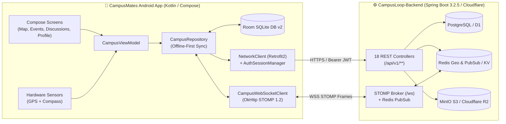
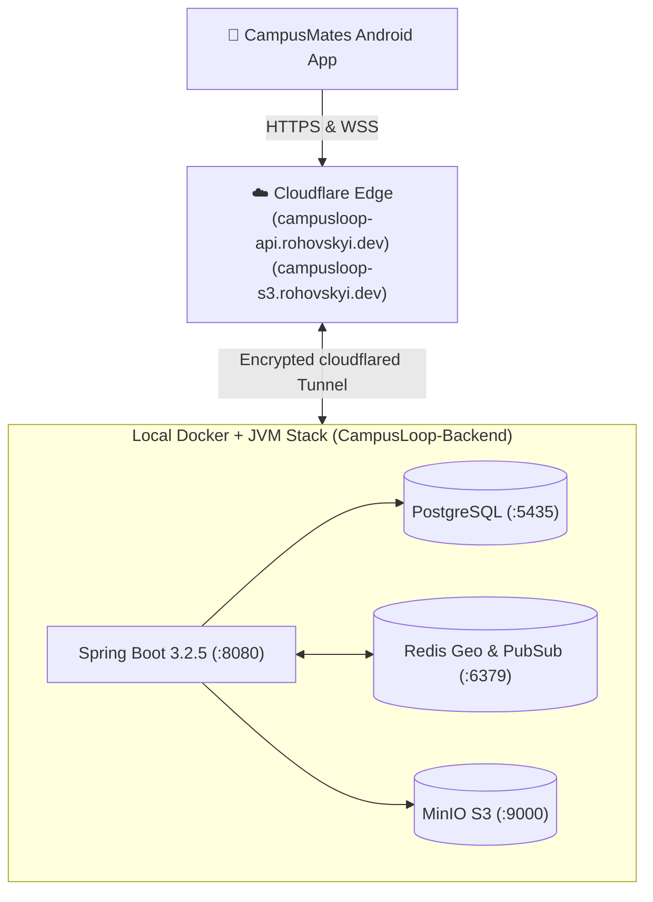

# CampusLoop (CampusMates) — AI Agentic Workflow & Next-Steps Playbook

> **Document Purpose:** Machine-readable, context-complete engineering specification and execution playbook designed for autonomous AI coding agents (Antigravity, Claude Code, Cursor, GitHub Copilot Workspace) to seamlessly execute the next phases of **CampusLoop Mobile + Backend + Cloudflare Edge Deployment**.
>
> **Last Updated:** November 9, 2026  
> **Mobile Repo Path:** `C:\Users\rusla\AndroidStudioProjects\CampusMates` (Branch: `MVP`)  
> **Backend Repo Path:** `C:\Users\rusla\AndroidStudioProjects\CampusLoop-Backend` (Branch: `main` @ `23b61dc`)  
> **Cloudflare Target Account:** `hazekk94@gmail.com` (`hazed0m` / Account ID `05632480b64ab36d4abdf0dc3e82d0b1`)

---

## 1. System Architecture & Current State Snapshot



### What Is Already Completed (`MVP` Branch)
1. **Local Persistence (Room v2):** 10 normalized entities (`UserEntity`, `EventEntity`, `EventParticipantEntity`, `FriendshipEntity`, `GroupEntity`, `GroupMemberEntity`, `LocationShareEntity`, `CampusNotificationEntity`, `AppSettingsEntity`, `PostEntity`, `CommentEntity`) + DAOs + seed data in `app/src/main/java/com/example/campusmates/data/local/`.
2. **Hardware Sensors:** Native Android `LocationManager` (`CampusLocationManager.kt`) + `SensorManager` (`CampusCompassSensorManager.kt`) + runtime OS permission launchers.
3. **Phase 1 Backend Integration (13 Controllers):** Auth, Verification, Password, UserProfile, UserProfileSearch, Group, GroupMembers, Post (with `isAnonymous`), Comment (threaded `parentId`), Event, EventParticipant, Friendship, Notification, and STOMP WebSocket client (`CampusWebSocketClient.kt`).

---

## 2. Delta Analysis: Latest Backend Commits (`e06ff39..23b61dc`)

On November 9, 2026, `CampusLoop-Backend` (`origin/main`) received **4 new commits** (`0ea5468`, `c56e9d1`, `31d5fa9`, `c133248`, `23b61dc`) introducing **5 new controllers**, **2 new STOMP real-time channels**, and **1 endpoint path fix**.

### 2.1 Breaking / Bug-Fix Changes (`0ea5468`)
| Component | Previous Backend Contract | New Backend Contract (`23b61dc`) | Required Android Action |
| :--- | :--- | :--- | :--- |
| `NotificationController` | `PATCH /api/v1/notifications/raed-all` (typo) | `PATCH /api/v1/notifications/read-all` | Update `@PATCH` path in `CampusApiInterfaces.kt` (`NotificationApi.markAllAsRead`) |
| `SecurityConfig` | No CORS / `/ws/**` blocked without HTTP header | CORS enabled + `/ws/**` `permitAll()` (JWT verified in STOMP `CONNECT` header) | Ready for browser/edge & mobile WebSocket handshake |

### 2.2 New Backend Feature 1: Channels & Real-Time Chat (`c56e9d1`)
Uses 64-bit Snowflake IDs (`Long`) for channels, members, and messages.

* **`ChannelController` (`/api/v1/channels`)**:
  * `POST /api/v1/channels` — Request: `CreateChannelRequest(groupId: UUID?, name: String?, type: ChannelType [GROUP_TEXT | DIRECT])` -> `201 Created` `ChannelResponse`
  * `PUT /api/v1/channels/{channelId}` — Request: `EditChannelRequest(name: String)` -> `200 OK` `ChannelResponse`
  * `DELETE /api/v1/channels/{channelId}` -> `204 No Content`
  * `GET /api/v1/channels/group/{groupId}?page=0&size=20` -> `SliceResponse<ChannelResponse>`
  * `GET /api/v1/channels/{channelId}` -> `ChannelResponse`
* **`ChannelMemberController` (`/api/v1/channels`)**:
  * `POST /api/v1/channels/{channelId}/members?userId={uuid}` -> `201 Created` `ChannelMemberResponse`
  * `DELETE /api/v1/channels/{channelId}/members/{memberId}` -> `204 No Content`
  * `GET /api/v1/channels/{channelId}/members?page=0&size=50` -> `SliceResponse<ChannelMemberResponse>`
  * `GET /api/v1/channels/me?page=0&size=20` -> `SliceResponse<ChannelResponse>`
  * `POST /api/v1/channels/direct?userId={uuid}` -> `200 OK` `ChannelResponse` (gets or creates a 1-on-1 DM channel)
* **`MessageController` (`/api/v1/channels/{channelId}/messages`)**:
  * `POST /api/v1/channels/{channelId}/messages` — Request: `CreateMessageRequest(content: String, parentMessageId: Long? = null)` -> `201 Created` `MessageResponse`
  * `PUT /api/v1/channels/{channelId}/messages/{messageId}` — Request: `EditMessageRequest(content: String)` -> `200 OK` `MessageResponse`
  * `DELETE /api/v1/channels/{channelId}/messages/{messageId}` -> `204 No Content`
  * `GET /api/v1/channels/{channelId}/messages/{messageId}` -> `MessageResponse`
  * `GET /api/v1/channels/{channelId}/messages/last` -> `LastMessageResponse` (`404` if empty)
  * `GET /api/v1/channels/{channelId}/messages?cursorId={long?}&direction={BEFORE|AFTER}&size=30` -> `SliceResponse<LastMessageResponse>`
* **STOMP WebSocket Broadcast (`MessageDispatchService`)**:
  * Topic: `/topic/channels/{channelId}/messages`
  * Envelope: `RealtimeMessage<MessageResponse>(action: CREATED | UPDATED | DELETED, entityId: Long, payload: MessageResponse?, timestamp: Instant)`

### 2.3 New Backend Feature 2: Real-Time Geo Location & Ghost Mode (`31d5fa9`)
Backed by Redis Geo (`GEOADD`, `GEOPOS`, `GEORADIUS`) and filtered to mutual accepted friends.

* **`GeoLocationController` (`/api/v1/geo`)**:
  * `POST /api/v1/geo/location` — Request: `UpdateLocationRequest(longitude: Double, latitude: Double)` -> `200 OK`
  * `DELETE /api/v1/geo/ghost` — Removes user coordinates from Redis Geo and notifies friends -> `204 No Content`
  * `GET /api/v1/geo/friends?radiusMeters=5000.0` -> `List<UserLocationDto>` (`userId: UUID, longitude: Double, latitude: Double, updatedAt: Instant`)
* **STOMP WebSocket User Queue (`GeoLocationServiceImpl`)**:
  * Destination: `/user/queue/geo/friends`
  * Envelope: `RealtimeMessage<UserLocationDto>(action: UPDATED | DELETED, entityId: UUID, payload: UserLocationDto?)`

### 2.4 New Backend Feature 3: Presigned Object Storage (`c133248`, `23b61dc`)
Backed by MinIO / S3-compatible storage (with 24-hour auto-expiration rule on `temp/`).

* **`StorageController` (`/api/v1/storage`)**:
  * `POST /api/v1/storage/upload-url` — Request: `CreateUploadUrlRequest(folderName: String, fileName: String)` -> `200 OK` `PresignedUrlResponse(uploadUrl: String, fileKey: String)` (scoped to `{folderName}/{userId}/{uuid}_{fileName}`)
  * `DELETE /api/v1/storage` — Request: `DeleteFileRequest(fileKey: String)` -> `204 No Content` (enforces `fileKey.contains(userId)` ownership check, returns `403 Forbidden` otherwise)

---

## 3. Cloudflare Deployment Architecture (`hazed0m` Account)

### Environment Facts Discovered
* **Authenticated CLI:** `npx wrangler whoami` is logged in as `hazekk94@gmail.com` (`Account ID: 05632480b64ab36d4abdf0dc3e82d0b1`).
* **Custom Domain on Account:** `rohovskyi.dev` is active on this Cloudflare account.
* **Plan Constraint:** Account is on the **Cloudflare Workers Free Plan**. Calling `wrangler containers` returns `Unauthorized: Deploying containers requires the Workers Paid plan`.

### Architectural Decision: Chosen Deployment Method

> **SELECTED METHOD: Track B — Native Spring Boot + Docker Compose (`Postgres` + `Redis` + `MinIO`) Exposed via Cloudflare Tunnel (`cloudflared`) on `rohovskyi.dev`**

#### Why Track B Is Strongly Superior for This Written Backend
1. **100% Native Code Execution (Zero Rewrite):** `CampusLoop-Backend` is a full Kotlin 1.9 + Spring Boot 3.2.5 JVM application (60+ source files) using Spring Security, JPA/Hibernate, `SimpMessagingTemplate` STOMP broker, Redis `GEORADIUS` (`RedisGeoRepository`), and the `io.minio` S3 client. Cloudflare Workers only run JS/Wasm on V8 isolates and cannot run JVM bytecode. Track B runs the **exact written backend** without rewriting or mocking a single controller.
2. **Bypasses the Workers Paid Plan Container Restriction for Free:** While Cloudflare Containers requires a paid subscription, **Cloudflare Tunnels (`cloudflared`) are 100% free** on your `hazekk94@gmail.com` account and support custom subdomains under `rohovskyi.dev` with automatic TLS (`HTTPS`) and WebSocket (`WSS`) termination.
3. **Presigned S3 URLs + Redis Geo Work Out-of-the-Box:** `docker-compose.yml` already provisions `campusloop-db` (`:5435`), `campusloop-redis` (`:6379`), and `campusloop-minio` (`:9000`). Exposing both `:8080` (`campusloop-api.rohovskyi.dev`) and `:9000` (`campusloop-s3.rohovskyi.dev`) via `cloudflared` makes REST, STOMP WebSockets, and MinIO presigned uploads work globally on any Android emulator or physical phone.



#### Step-by-Step Track B Execution Guide for Agents
1. **Start Backend Infrastructure (`Postgres`, `Redis`, `MinIO`):**
   ```powershell
   docker compose -f C:\Users\rusla\AndroidStudioProjects\CampusLoop-Backend\docker-compose.yml up -d
   ```
2. **Ensure `src/main/resources/application.yml` Exists in `CampusLoop-Backend`:**
   *(Note: `application.yml` is gitignored for security; create it if missing)*:
   ```yaml
   server:
     port: 8080
   spring:
     datasource:
       url: jdbc:postgresql://localhost:5435/campusloop
       username: user
       password: password
     jpa:
       hibernate:
         ddl-auto: update
     data:
       redis:
         host: localhost
         port: 6379
   app:
     s3:
       endpoint: http://localhost:9000
       access-key: minioadmin
       secret-key: minioadminpassword
       region: us-east-1
       bucket-name: campusloop
   ```
3. **Run Spring Boot & Expose via Cloudflare Tunnel:**
   ```powershell
   # Terminal 1: Start Spring Boot
   cd C:\Users\rusla\AndroidStudioProjects\CampusLoop-Backend
   .\mvnw.cmd spring-boot:run

   # Terminal 2: Expose over Cloudflare Edge (Quick Tunnel or Named Domain on rohovskyi.dev)
   cloudflared tunnel --url http://localhost:8080
   ```
4. *(Fallback Track A — Serverless Cloudflare Worker + D1)*: Only use if a lightweight mock edge server is needed when the Docker host is offline.

---

## 4. Step-by-Step AI Agent Execution Tasks

An AI agent picking up this repository should execute the following tasks in order. Each task is self-contained with explicit file paths and verification commands.

### Task 1: Sync Android Remote DTOs & Retrofit API Interfaces with Backend `23b61dc`
* **Target Files:**
  * [`RemoteModels.kt`](file:///c:/Users/rusla/AndroidStudioProjects/CampusMates/app/src/main/java/com/example/campusmates/data/remote/model/RemoteModels.kt)
  * [`CampusApiInterfaces.kt`](file:///c:/Users/rusla/AndroidStudioProjects/CampusMates/app/src/main/java/com/example/campusmates/data/remote/api/CampusApiInterfaces.kt)
  * [`NetworkClient.kt`](file:///c:/Users/rusla/AndroidStudioProjects/CampusMates/app/src/main/java/com/example/campusmates/data/remote/client/NetworkClient.kt)
* **Instructions:**
  1. In `CampusApiInterfaces.kt`, fix `NotificationApi.markAllAsRead` from `@PATCH("api/v1/notifications/raed-all")` to `@PATCH("api/v1/notifications/read-all")`.
  2. Add DTOs to `RemoteModels.kt`:
     * `CreateChannelRequest`, `EditChannelRequest`, `ChannelResponse`, `ChannelMemberResponse`
     * `CreateMessageRequest`, `EditMessageRequest`, `MessageDto` (matching backend `MessageResponse`), `LastMessageResponse`
     * `UpdateLocationRequest`, `UserLocationDto`
     * `CreateUploadUrlRequest`, `DeleteFileRequest`, `PresignedUrlResponse`
  3. Add Retrofit interfaces `ChannelApi`, `MessageApi`, `GeoApi`, and `StorageApi` in `CampusApiInterfaces.kt` and expose them on `NetworkClient.kt`.

### Task 2: Integrate Real-Time Geo Location & Ghost Mode into `SocialMapScreen`
* **Target Files:**
  * [`CampusWebSocketClient.kt`](file:///c:/Users/rusla/AndroidStudioProjects/CampusMates/app/src/main/java/com/example/campusmates/data/remote/client/CampusWebSocketClient.kt)
  * [`CampusRepository.kt`](file:///c:/Users/rusla/AndroidStudioProjects/CampusMates/app/src/main/java/com/example/campusmates/data/repository/CampusRepository.kt)
  * [`CampusViewModel.kt`](file:///c:/Users/rusla/AndroidStudioProjects/CampusMates/app/src/main/java/com/example/campusmates/ui/state/CampusViewModel.kt)
* **Instructions:**
  1. Subscribe to `/user/queue/geo/friends` in `CampusWebSocketClient.kt` on STOMP connect.
  2. When GPS location updates in `CampusViewModel` and `LocationSharingMode != OFF`, call `POST /api/v1/geo/location`.
  3. When user switches `LocationSharingMode` to `OFF` (Ghost Mode), call `DELETE /api/v1/geo/ghost`.
  4. Merge remote friend coordinates from `GET /api/v1/geo/friends` and `/user/queue/geo/friends` into `LocationShareEntity` in Room so mutual friends render live on `SocialMapScreen`.

### Task 3: Integrate Channels & Real-Time Direct/Group Messaging into `DiscussionsFeedScreen`
* **Target Files:**
  * [`Entities.kt`](file:///c:/Users/rusla/AndroidStudioProjects/CampusMates/app/src/main/java/com/example/campusmates/data/local/entity/Entities.kt) & [`Daos.kt`](file:///c:/Users/rusla/AndroidStudioProjects/CampusMates/app/src/main/java/com/example/campusmates/data/local/dao/Daos.kt)
  * [`DiscussionsFeedScreen.kt`](file:///c:/Users/rusla/AndroidStudioProjects/CampusMates/app/src/main/java/com/example/campusmates/ui/screens/DiscussionsFeedScreen.kt)
* **Instructions:**
  1. Add `ChannelEntity` and `ChatMessageEntity` to Room (`CampusDatabase` v3).
  2. Add a segmented toggle in `DiscussionsFeedScreen.kt` between **Group Posts (Forum)** and **Live Channels / DMs (`GROUP_TEXT` & `DIRECT`)**.
  3. Subscribe dynamically to `/topic/channels/{channelId}/messages` when a channel is opened, rendering real-time `CREATED`, `UPDATED`, and `DELETED` message events.

### Task 4: Integrate Presigned Media Uploads (`StorageController`)
* **Target Files:**
  * [`ProfileAndSettingsScreens.kt`](file:///c:/Users/rusla/AndroidStudioProjects/CampusMates/app/src/main/java/com/example/campusmates/ui/screens/ProfileAndSettingsScreens.kt)
* **Instructions:**
  1. Request presigned URL via `POST /api/v1/storage/upload-url` (`folderName = "avatars"` or `"events"`).
  2. Perform binary `PUT` upload directly to `uploadUrl` using OkHttp.

---

## 5. Verification & Guardrail Commands for Agents

Always run these verification commands after making changes:

```powershell
# 1. Run all unit & serialization tests
.\gradlew.bat testDebugUnitTest

# 2. Assemble Debug APK and verify zero Kotlin/KSP compilation errors
.\gradlew.bat assembleDebug

# 3. Check Cloudflare Wrangler authentication & deployment status
npx wrangler whoami
```
