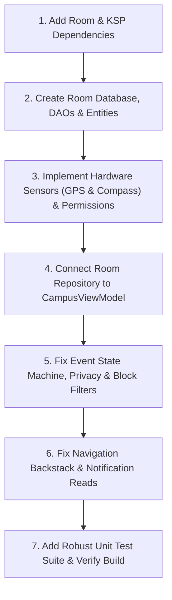

# CampusLoop Mobile — Comprehensive Bug Report List & MVP Gap Analysis

> **Project:** CampusLoop Mobile (TU Dublin Grangegorman Campus Social Map)  
> **Target Platform:** Android (Kotlin, Jetpack Compose, Material 3)  
> **Inspection Date:** 4 November 2026  
> **Baseline Assignment/Milestone Reference:** Milestone 1 Architecture Proposal & Product Description  
> **Status:** Local Prototype Audit & Remediation Plan

---

## 1. Executive Summary

An in-depth codebase audit of **CampusLoop Mobile** reveals that while the Jetpack Compose visual interfaces and navigation routing were constructed, **the underlying functionality was entirely simulated or absent**:
1. **Zero Database Persistence:** There was no SQLite/Room implementation (`@Database`, `@Entity`, `@Dao`). All state lived exclusively in transient in-memory objects within `CampusViewModel`. Closing or restarting the application wiped all user creations, joined events, new groups, profile edits, and friendship updates.
2. **Missing Real Android Hardware Sensors:** The two promised sensors (GPS Location Provider and Magnetometer/Compass) were completely simulated with static values. No Android `LocationManager` or `FusedLocationProviderClient` was integrated; no `SensorManager` or orientation listener was registered. Rotating the phone or walking across campus had zero effect.
3. **No OS Runtime Permission Requests:** Although location permissions were declared in `AndroidManifest.xml`, the app never requested runtime permissions from the Android OS. Tapping "Grant GPS" merely toggled an internal boolean flag without prompting the user.
4. **Logical Defects in Event Lifecycle & Concurrency:** Start/end times were corrupted by substring slicing; leaving full events reset active events to open; private events blocked pending request creation when full; blocked users' events remained visible on the map and feed.
5. **Static Notifications & Incomplete Interactivity:** Tapping an unread notification failed to mark it as read, and actions (joining, creating, friending) generated zero notifications.
6. **Lack of Unit Tests:** Only the default dummy `ExampleUnitTest` existed, with zero test coverage for state transitions, database operations, or filtering logic.

---

## 2. Bug & Deficiency Inventory

| Bug ID | Category | Severity | Title & Summary |
|---|---|---|---|
| **BUG-01** | Architecture / Persistence | **Critical** | **Room Local Database completely missing** — No Room dependencies, entities, DAOs, or database builder. All data resides in volatile in-memory StateFlow. |
| **BUG-02** | Hardware Sensors | **Critical** | **Android GPS Location not integrated** — App does not connect to device GPS; position on campus is hardcoded to a mock coordinate. |
| **BUG-03** | Android OS / Permissions | **Critical** | **Runtime location permissions never requested** — The app never invokes `ActivityResultContracts.RequestMultiplePermissions` or checks OS permissions. |
| **BUG-04** | Hardware Sensors | **High** | **Compass orientation sensor is simulated** — Hardware `SensorManager` (`TYPE_ROTATION_VECTOR` / `TYPE_MAGNETIC_FIELD`) is not hooked up; azimuth is an incremented hardcoded float. |
| **BUG-05** | Privacy & Safety | **High** | **Blocked user events and presence are not filtered** — Events organized by blocked students still appear in the map and feed, violating safety specifications. |
| **BUG-06** | Event Lifecycle | **High** | **`CreateEvent` start/end time parsing corruption** — Substring parsing leaves unmatched parentheses (`(15:00`), corrupting time labels across cards and details. |
| **BUG-07** | Event Lifecycle | **High** | **Status rollback bug on event leave** — Leaving an event when it was `IN_PROGRESS` or `FULL` resets it unconditionally to `OPEN`. |
| **BUG-08** | Event Lifecycle | **Medium** | **Private event request lock when full** — Prospective attendees cannot request access to private meetups if capacity has been reached by current attendees, blocking waitlists. |
| **BUG-09** | Navigation & Backstack | **Medium** | **Form retention on backstack after publish** — Navigating from `CreateEvent` to `EventDetails` preserves the dirty form on the backstack instead of popping it. |
| **BUG-10** | Notifications | **Medium** | **Opening unread notifications does not mark them as read** — Tapping an alert navigates but leaves `isUnread = true`. |
| **BUG-11** | Notifications | **Medium** | **User actions do not generate durable notifications** — Event creation, join requests, approvals, and friend requests do not record notifications. |
| **BUG-12** | Social / Friends | **Low** | **Misleading banner when rejecting friend requests** — Declining an incoming friend request announces "Connection removed" instead of "Request declined". |
| **BUG-13** | Social / Friends | **Low** | **Outgoing friend request cannot be cancelled** — The user cannot withdraw a pending friend request once sent. |
| **BUG-14** | UI / Accessibility | **Medium** | **Hardcoded strings instead of Android resource strings** — Hundreds of inline `if (lang == RU)` strings bypass Android resource catalogs. |
| **BUG-15** | UI / Ergonomics | **Low** | **`NearbyListAlternative` hardcoded padding clipping** — Fixed `96.dp` top padding clips content on smaller displays. |
| **BUG-16** | Testing & Quality | **High** | **Zero unit test coverage** — No tests exist for domain models, state flow transitions, or repository logic. |

---

## 3. Deep Dive into Critical & High Issues

### BUG-01: Room Database Completely Missing (Persistence Defect)
* **Contracted Spec:** Milestone 1 Document §2 (Part III Data Storage) and §3.ii specify an offline-first SQLite cache using Room with 8 normalized entities (`UserEntity`, `EventEntity`, `EventParticipantEntity`, `FriendshipEntity`, `GroupEntity`, `GroupMemberEntity`, `LocationShareEntity`, `AppSettingsEntity`) and corresponding DAOs.
* **Root Cause:** Neither `androidx.room` nor KSP was configured in `build.gradle.kts`. `CampusViewModel` directly initialized its `MutableStateFlow` from `CampusSeedData`.
* **Fix Required:** Add Room runtime, KTX, and KSP compiler plugins. Implement entity schemas with TypeConverters for Enums and Lists. Build a reactive `CampusRepository` wrapping `CampusDatabase` that emits flows to `CampusViewModel`.

### BUG-02 & BUG-03: GPS Location & Runtime Permission Failure
* **Contracted Spec:** Milestone 1 Document §2 (Part I Data Input) requires foreground GPS location via Android OS location providers, computing coarse campus zone distances and rendering user position.
* **Root Cause:** `SocialMapScreen.kt` and `CampusViewModel.kt` only manipulated a boolean `isDeviceGpsPermissionGranted`. No permission launcher or `LocationManager` callback existed.
* **Fix Required:** Implement a native `LocationProvider` utility using Android's `LocationManager`. Register a Jetpack Compose `rememberLauncherForActivityResult(ActivityResultContracts.RequestMultiplePermissions())` that verifies OS permissions before polling location. Compute Haversine distance from the device's real coordinates to campus zones.

### BUG-04: Compass Orientation Sensor Hardcoded
* **Contracted Spec:** Milestone 1 Document §2 (Part I Data Input) & §3.iii requirement: Hardware orientation sensor (`TYPE_ROTATION_VECTOR` / `TYPE_MAGNETIC_FIELD`) computing azimuth bearing (e.g. `318° NW`).
* **Root Cause:** `CampusViewModel.rotateCompassBearing()` simply executed `(bearing + 45f) % 360f`.
* **Fix Required:** Implement a lifecycle-aware `OrientationSensorManager` that listens to `Sensor.TYPE_ROTATION_VECTOR` or accelerometer+magnetometer via `SensorManager.getRotationMatrix` and `SensorManager.getOrientation`, feeding real-time degrees to the UI.

### BUG-05: Blocked Users' Events Still Visible
* **Contracted Spec:** PRODUCT_DESCRIPTION.md §5: "Rules: block status filters profile search, friend lists, location projections, event visibility, and notifications."
* **Root Cause:** `SocialMapScreen.kt` and `EventsFeedScreen.kt` only checked `event.status != EventStatus.CANCELLED`.
* **Fix Required:** Filter out any events where `event.organizer.userId` belongs to a user with `FriendshipState.BLOCKED`.

### BUG-06 & BUG-07: Event Time Corruption & State Rollback
* **Contracted Spec:** Event creation must record valid start/end times and preserve valid event states.
* **Root Cause:** String splitting on `–` vs `-` resulted in unclosed parens. `leaveEvent` blindly reverted `status` to `OPEN` even if the event was previously in progress or expired.
* **Fix Required:** Sanitize time preset parsing and enforce state machine rules that only revert `FULL` to `OPEN` if the event is not already completed, expired, or live.

---

## 4. MVP Completion Roadmap

This ensures full compliance with the Milestone 1 criteria, producing a fully functional, persistent, and verifiable Android MVP.
