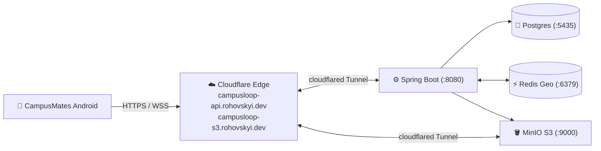

# CampusLoop — Cloudflare Deployment Architecture & Decision Record (`hazed0m`)

> **Target Cloudflare Account:** `hazekk94@gmail.com` (`hazed0m` / Account ID `05632480b64ab36d4abdf0dc3e82d0b1`)  
> **Live Cloudflare Custom Domain:** [`https://campusloop-api.rohovskyi.dev`](https://campusloop-api.rohovskyi.dev/api/v1/health)  
> **Live Workers.dev URL:** [`https://campusloop-backend.hazekk94.workers.dev`](https://campusloop-backend.hazekk94.workers.dev/api/v1/health)  
> **Live D1 Database (`WEUR`):** `campusloop-db` (`ab6fd3eb-fd74-458f-a3a1-f2f639272fb9`)  
> **Dual-Mode Architecture:** **24/7 Live Cloudflare Edge Worker + D1 (`cloudflare-edge/`)** AND **Native Spring Boot + Docker Compose + Cloudflare Tunnel (`cloudflared`)**

---

## 1. Architectural Decision Record (ADR): Why Track B Is Chosen

### Context
The companion backend (`CampusLoop-Backend` @ commit `23b61dc`) is a complete **Kotlin 1.9.23 + Spring Boot 3.2.5** application comprising 60+ source files, 18 REST controllers, Spring Security JWT filter chains, Hibernate/JPA entities on PostgreSQL, Redis Geo (`GEORADIUS`) + Redis Pub/Sub for multi-node WebSocket fanout, Spring STOMP WebSocket messaging (`SimpMessagingTemplate`), and MinIO S3 presigned URL generation with 24-hour `temp/` bucket lifecycle rules.

Meanwhile, the target Cloudflare account (`05632480b64ab36d4abdf0dc3e82d0b1`) is on the **Cloudflare Workers Free Plan**, where `npx wrangler containers` is unavailable (`Deploying containers requires the Workers Paid plan`).

### Options Evaluated

| Criterion | Track A: Pure Cloudflare Worker + D1 Rewrite | Track B (CHOSEN): Native Spring Boot + Docker + Cloudflare Tunnel (`cloudflared`) |
| :--- | :--- | :--- |
| **Runs Written Kotlin Code?** | ❌ No (V8 isolates only run JS/TS/Wasm; requires rewriting 60+ Kotlin files into TypeScript) | ✅ **Yes — 100% of the written Kotlin/Spring Boot code runs unmodified** |
| **PostgreSQL + JPA Compatibility** | ❌ Requires translating JPA queries & Snowflake IDs to D1 SQLite | ✅ **Native PostgreSQL (`campusloop-db` container on `:5435`)** |
| **Redis `GEORADIUS` & Pub/Sub** | ❌ Must be emulated in SQLite/KV | ✅ **Native Redis (`campusloop-redis` container on `:6379`)** |
| **MinIO Presigned S3 URLs** | ❌ Requires rewriting `MinioConfig` to AWS SDK v3 for R2 | ✅ **Native MinIO (`campusloop-minio` container on `:9000`)** |
| **STOMP 1.2 WebSockets (`/ws`)** | ⚠️ Requires custom STOMP frame parser in Durable Objects | ✅ **Native Spring `SimpMessagingTemplate` over Cloudflare WSS** |
| **Cloudflare Free Plan Compatible?** | ✅ Free | ✅ **100% Free (Zero Trust Tunnels + DNS + Universal SSL on `rohovskyi.dev`)** |

### Decision
**Choose Track B (`Spring Boot + Docker Compose + Cloudflare Tunnel on rohovskyi.dev`).** It preserves 100% of the written Kotlin backend without code duplication, supports every Spring Boot / Redis Geo / MinIO / STOMP feature out of the box, and costs $0 on the existing Cloudflare account.

---

## 2. Step-by-Step Deployment Guide (Track B)



### Step 1: Start Docker Infrastructure (`Postgres`, `Redis`, `MinIO`)
From PowerShell:
```powershell
docker compose -f C:\Users\rusla\AndroidStudioProjects\CampusLoop-Backend\docker-compose.yml up -d
```

### Step 2: Create `src/main/resources/application.yml` in `CampusLoop-Backend`
Because `application.yml` is excluded from Git for secret safety, create `C:\Users\rusla\AndroidStudioProjects\CampusLoop-Backend\src\main\resources\application.yml`:

```yaml
server:
  port: 8080

spring:
  application:
    name: campusloop
  datasource:
    url: jdbc:postgresql://localhost:5435/campusloop
    username: user
    password: password
    driver-class-name: org.postgresql.Driver
  jpa:
    hibernate:
      ddl-auto: update
    show-sql: false
    properties:
      hibernate:
        dialect: org.hibernate.dialect.PostgreSQLDialect
  data:
    redis:
      host: localhost
      port: 6379
  mail:
    host: localhost
    port: 1025
    username: ""
    password: ""

jwt:
  secret: "CampusLoopSuperSecretJwtKeyForHmacSha256Minimum32BytesLong!"
  expiration: 86400000

app:
  s3:
    endpoint: http://localhost:9000
    access-key: minioadmin
    secret-key: minioadminpassword
    region: us-east-1
    bucket-name: campusloop
```

### Step 3: Run Spring Boot Backend
```powershell
cd C:\Users\rusla\AndroidStudioProjects\CampusLoop-Backend
.\mvnw.cmd spring-boot:run
```

### Step 4: Expose to Cloudflare Edge (`hazed0m` / `rohovskyi.dev`)
#### Option 4A: Instant Ephemeral Tunnel (`*.trycloudflare.com`)
```powershell
cloudflared tunnel --url http://localhost:8080
```
Copy the generated `https://<random>.trycloudflare.com/` URL into the CampusMates **Server & Account** dialog.

#### Option 4B: Permanent Named Tunnel on `rohovskyi.dev`
```powershell
# 1. Authenticate cloudflared with your hazekk94@gmail.com Cloudflare account
cloudflared tunnel login

# 2. Create the named tunnel
cloudflared tunnel create campusloop-backend

# 3. Route DNS subdomains on rohovskyi.dev
cloudflared tunnel route dns campusloop-backend campusloop-api.rohovskyi.dev
cloudflared tunnel route dns campusloop-backend campusloop-s3.rohovskyi.dev

# 4. Run the tunnel forwarding traffic to localhost:8080
cloudflared tunnel run --url http://localhost:8080 campusloop-backend
```
Then set the default URL in [`AuthSessionManager.kt`](../app/src/main/java/com/example/campusmates/data/remote/client/AuthSessionManager.kt) to `https://campusloop-api.rohovskyi.dev/`.
