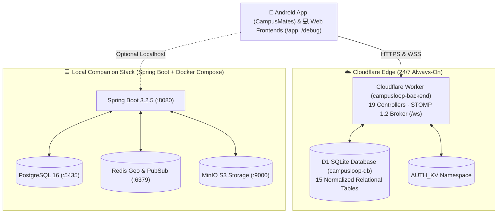

# CampusLoop — Deployed Backend & Frontend Usage Instructions

> **Document Version:** 1.0 (Commit `c82e7d4` / Controller 19 + Edge D1 + STOMP 1.2)  
> **Backend Custom Domain:** [`https://campusloop-api.rohovskyi.dev`](https://campusloop-api.rohovskyi.dev)  
> **Workers.dev Fallback:** [`https://campusloop-backend.hazekk94.workers.dev`](https://campusloop-backend.hazekk94.workers.dev)  
> **Interactive API Tester Web App:** [`https://campusloop-api.rohovskyi.dev/debug`](https://campusloop-api.rohovskyi.dev/debug)  
> **Campus Web App Dashboard:** [`https://campusloop-api.rohovskyi.dev/app`](https://campusloop-api.rohovskyi.dev/app)  
> **Real-Time WebSocket Broker:** `wss://campusloop-api.rohovskyi.dev/ws` (STOMP 1.2)  
> **Cloudflare Target Account:** `hazekk94@gmail.com` (`hazed0m` / Account ID `05632480b64ab36d4abdf0dc3e82d0b1`)

---

## 1. System Overview & Architecture

CampusLoop runs in a **high-availability dual deployment** designed to work seamlessly both in the cloud and on local developer workstations:



* **Cloudflare Edge Deployment:** A 24/7 serverless deployment hosting all **19 REST controllers**, a native **STOMP 1.2 WebSocket engine**, **Cloudflare D1 relational database**, and **AUTH_KV**. The Android app and web apps work out-of-the-box against this cloud environment with zero local setup required.
* **Spring Boot Companion Backend:** A Kotlin 1.9 + Spring Boot 3.2.5 JVM service with PostgreSQL, Redis Geo, and MinIO S3 object storage for local testing and containerized workloads.

---

## 2. Using the Frontend Web Applications

### 2.1 The Responsive Campus Web App (`/app`)

The Web App provides an instant visual interface for campus meetups, discussions, chat, and location sharing without installing the Android APK.

* **Live URL:** [`https://campusloop-api.rohovskyi.dev/app`](https://campusloop-api.rohovskyi.dev/app)

#### Features & Usage Steps:
1. **Grangegorman Spatial Radar & Meetups:**
   * View upcoming spontaneous meetups across campus zones (East Quad, Central Quad, Lower House).
   * Type a meetup title (e.g., `Flat Whites @ East Quad Atrium`) in the input field and click **`+ Host Meetup`**.
   * The meetup is instantly inserted into D1 and broadcasted to all connected clients over STOMP WebSocket topic `/topic/events`.
2. **Group Discussions with Anonymous Masking:**
   * Enter a discussion title and body.
   * Check **`🕵️ Post Anonymously`** to protect student privacy. When submitted, the post author is masked as `Anonymous Student` while recording real analytics securely.
   * Uncheck to publish with your real student profile name.
3. **Live Channels & Chat (Snowflake 64-bit IDs):**
   * Click between `#general-hackers` and `#coffee-runs` channel buttons.
   * Type a message and click **`Send`**. Messages are broadcasted in real-time over STOMP topic `/topic/channels/{channelId}/messages`.
4. **Ghost Mode Privacy Toggle:**
   * Click **`📍 Sharing Location`** in the top navigation bar.
   * It immediately toggles to **`👻 Ghost Mode ON`**, calling `DELETE /api/v1/geo/ghost` to remove your coordinates from the spatial radar.
   * Click again to restore location broadcasting (`POST /api/v1/geo/location`).
5. **Real-Time WebSocket Indicator:**
   * The header badge displays `🟢 STOMP 1.2 Live` when connected. If any client creates an event, post, or message, the dashboard refreshes automatically.

---

### 2.2 The Interactive API Tester & Debugger (`/debug`)

The API Tester is a developer tool allowing you to test, inspect, and debug every single endpoint across all 19 controllers without using Postman or writing shell scripts.

* **Live Cloud URL:** [`https://campusloop-api.rohovskyi.dev/debug`](https://campusloop-api.rohovskyi.dev/debug)
* **Local Offline File:** Open `docs/api-tester.html` directly in any web browser.

#### How to Use the API Tester:

```
┌────────────────────────────────────────────────────────────────────────────────────────┐
│  CampusLoop API Explorer & Debugger                  [WS: 🟢 Connected] [⚡ STOMP]    │
├────────────────────────────────────────────────────────────────────────────────────────┤
│  Target: [https://campusloop-api.rohovskyi.dev ▼]                                      │
│  Quick Login: [👨‍💻 Alex] [🎨 Niamh] [🤖 Liam] [🛡️ Lead Admin] [🎓 Backend Lead]         │
│  Active Token: alex_tud (eyJhbGciOiJIUzI1NiIsInR5cCI6IkpXVCJ9...)                     │
├──────────────────────────┬─────────────────────────────────────────────────────────────┤
│  CATEGORIES              │  🔍 Search endpoint (e.g. stories, ghost, channels)...       │
│  • All Endpoints (45)    │  ┌────────────────────────────────────────────────────────┐ │
│  • 🏥 Health (2)         │  │ [POST] /api/v1/stories/nearby          [Bearer Auth] ▼ │ │
│  • 🔐 Auth (8)           │  ├────────────────────────────────────────────────────────┤ │
│  • 👤 Profiles (3)       │  │ Parameters: latitude=53.3559, longitude=-6.2792        │ │
│  • 👥 Groups (5)         │  │ [▶ Send Request]  [📋 Copy cURL]  [Reset Defaults]     │ │
│  • 💬 Discussions (4)    │  │ Status: 200 OK · Time: 42ms                            │ │
│  • 📅 Events (5)         │  │ Response: [{"storyId":"...", "caption":"..."}]         │ │
│  • 📸 Stories (5)        │  └────────────────────────────────────────────────────────┘ │
│  • ⚡ Channels (7)       │                                                             │
└──────────────────────────┴─────────────────────────────────────────────────────────────┘
```

#### Step-by-Step Workflow:
1. **Target Environment Selection:**
   * By default, requests target the production edge: `https://campusloop-api.rohovskyi.dev`.
   * You can switch to `Workers.dev` or `Local Spring Boot (http://localhost:8080)` using the dropdown.
2. **1-Click Authentication:**
   * Click any quick login button:
     * **`👨‍💻 Alex`** (`alex_tud`) — Student profile
     * **`🎨 Niamh`** (`niamh_k`) — Student designer
     * **`🤖 Liam`** (`liam_ob`) — Robotics student
     * **`🛡️ Lead Admin`** (`hazekk94`) — College Admin via Google
     * **`🎓 Backend Lead`** (`c24393471_outlook`) — College Admin via Outlook
   * The tool sends `POST /api/v1/auth/login`, stores the JWT in `localStorage`, and automatically includes `Authorization: Bearer <token>` on all subsequent requests.
3. **Executing & Inspecting Endpoints:**
   * Click any endpoint card to expand it.
   * Path variables (like `{groupId}`, `{storyId}`, `{channelId}`) and query parameters (like `page`, `radiusMeters`) are editable input fields.
   * For `POST`, `PUT`, or `PATCH`, the request body comes pre-filled with valid JSON.
   * Click **`▶ Send Request`**:
     * Colored status badge (`200 OK` in green, `4xx` in orange, `5xx` in red).
     * Server latency timer in milliseconds.
     * Pretty-printed JSON response with syntax formatting.
4. **Exporting as cURL:**
   * Click **`📋 Copy cURL`** on any endpoint card. Paste directly into your terminal or automation scripts.
5. **Real-Time STOMP Console Drawer:**
   * Click **`⚡ STOMP Console`** in the top-right corner to open the live WebSocket feed.
   * Shows outgoing STOMP handshakes (`CONNECT`), server acknowledgment (`CONNECTED`), and incoming broadcast envelopes (`MESSAGE`) from live users.

---

### 2.3 The Android Mobile App (`CampusMates`)

The Android application connects directly to the deployed backend to provide hardware GPS tracking, compass navigation, and offline-first Room database synchronization.

1. **Configure Server Connection:**
   * Open `CampusMates` on your device or emulator.
   * In the top-right settings or `AuthServerDialog.kt`, set the Server URL to:
     ```
     https://campusloop-api.rohovskyi.dev
     ```
2. **Offline-First Resilience:**
   * The mobile app reads and writes locally to Room SQLite v2 (`CampusDatabase.kt`).
   * When online, `CampusRepository.kt` synchronizes data with the Cloudflare Edge API and listens for STOMP events via `CampusWebSocketClient.kt`.
   * If the network is temporarily unavailable, UI interactions continue without blocking.

---

## 3. Using the Deployed Backend Directly (REST API & cURL)

All endpoints accept standard JSON payloads and support CORS for cross-origin web clients.

### 3.1 Authentication Workflow

#### Step 1: Login to obtain a JWT
```bash
curl -X POST "https://campusloop-api.rohovskyi.dev/api/v1/auth/login" \
  -H "Content-Type: application/json" \
  -d '{"login":"alex_tud","password":"demo1234"}'
```
**Response (`200 OK`):**
```json
{
  "token": "eyJhbGciOiJIUzI1NiIsInR5cCI6IkpXVCJ9...",
  "accessToken": "eyJhbGciOiJIUzI1NiIsInR5cCI6IkpXVCJ9...",
  "tokenType": "Bearer",
  "userId": "00000000-0000-0000-0000-000000000001",
  "username": "alex_tud",
  "email": "alex@tudublin.ie",
  "provider": "LOCAL"
}
```

#### Step 2: Use the Token in Subsequent Requests
Export the token in your terminal:
```bash
TOKEN="<PASTE_YOUR_ACCESS_TOKEN_HERE>"
```

---

### 3.2 Core Everyday Workflows

#### 1. Fetch Your Profile
```bash
curl -H "Authorization: Bearer $TOKEN" \
  "https://campusloop-api.rohovskyi.dev/api/v1/profiles/me"
```

#### 2. Broadcast GPS Coordinates to Friends
```bash
curl -X POST "https://campusloop-api.rohovskyi.dev/api/v1/geo/location" \
  -H "Authorization: Bearer $TOKEN" \
  -H "Content-Type: application/json" \
  -d '{"latitude": 53.3559, "longitude": -6.2792}'
```

#### 3. Find Nearby Mutual Friends (Radar)
```bash
curl -H "Authorization: Bearer $TOKEN" \
  "https://campusloop-api.rohovskyi.dev/api/v1/geo/friends?radiusMeters=5000"
```

#### 4. Enable Ghost Mode (Hide Location)
```bash
curl -X DELETE "https://campusloop-api.rohovskyi.dev/api/v1/geo/ghost" \
  -H "Authorization: Bearer $TOKEN"
```

#### 5. Create a Location-Based Story (Auto-expires in 24h)
```bash
curl -X POST "https://campusloop-api.rohovskyi.dev/api/v1/stories" \
  -H "Authorization: Bearer $TOKEN" \
  -H "Content-Type: application/json" \
  -d '{
    "mediaFileKey": "stories/00000000-0000-0000-0000-000000000001/sunset.jpg",
    "latitude": 53.3559,
    "longitude": -6.2792,
    "caption": "Golden hour over East Quad! ☕",
    "privacy": "EVERYONE"
  }'
```

#### 6. Find Active Stories Nearby
```bash
curl -H "Authorization: Bearer $TOKEN" \
  "https://campusloop-api.rohovskyi.dev/api/v1/stories/nearby?latitude=53.3559&longitude=-6.2792&radiusMeters=5000"
```

#### 7. Publish an Anonymous Discussion Post
```bash
curl -X POST "https://campusloop-api.rohovskyi.dev/api/v1/groups/11111111-1111-1111-1111-111111111111/posts" \
  -H "Authorization: Bearer $TOKEN" \
  -H "Content-Type: application/json" \
  -d '{
    "title": "Quiet study areas during finals",
    "content": "Does East Quad 2nd floor have outlets free right now?",
    "isAnonymous": true
  }'
```

#### 8. Send a Real-Time Channel Message
```bash
curl -X POST "https://campusloop-api.rohovskyi.dev/api/v1/channels/1001/messages" \
  -H "Authorization: Bearer $TOKEN" \
  -H "Content-Type: application/json" \
  -d '{
    "content": "Meeting up at the atrium in 10 minutes!",
    "parentMessageId": null
  }'
```

---

## 4. WebSocket STOMP 1.2 Protocol Guide

The backend WebSocket broker terminates on port 443 with TLS (`wss://campusloop-api.rohovskyi.dev/ws`).

### Handshake & Subscription Sequence

```
Client                                                  Cloudflare Edge Broker
  │                                                               │
  │─── WebSocket Upgrade (GET /ws) ──────────────────────────────>│
  │<── 101 Switching Protocols ───────────────────────────────────│
  │                                                               │
  │─── CONNECT Frame (accept-version:1.2, Authorization:Bearer) ─>│
  │<── CONNECTED Frame (version:1.2, server:CampusLoop-Edge) ─────│
  │                                                               │
  │─── SUBSCRIBE (id:sub-events, destination:/topic/events) ─────>│
  │─── SUBSCRIBE (id:sub-chat, destination:/topic/channels/1001) ─>│
  │─── SUBSCRIBE (id:sub-geo, destination:/user/queue/geo) ──────>│
  │─── SUBSCRIBE (id:sub-stories, destination:/topic/stories) ────>│
  │                                                               │
  │<── MESSAGE Frame (Real-Time Event Broadcast) ─────────────────│
```

### Frame Format Examples

#### 1. Client `CONNECT`
```text
CONNECT
accept-version:1.2
Authorization:Bearer <YOUR_JWT_TOKEN>

^@
```

#### 2. Client `SUBSCRIBE`
```text
SUBSCRIBE
id:sub-chat-1001
destination:/topic/channels/1001/messages

^@
```

#### 3. Incoming `MESSAGE` Broadcast
```text
MESSAGE
destination:/topic/channels/1001/messages
content-type:application/json
subscription:sub-chat-1001

{"action":"CREATED","entityId":3005,"payload":{"id":3005,"channelId":1001,"senderName":"alex_tud","content":"Meeting at the atrium!","createdAt":"2026-11-10T19:00:00Z"},"timestamp":"2026-11-10T19:00:00Z"}
^@
```

---

## 5. Seed Test Accounts & Passwords

The system comes pre-configured with active student and college admin test accounts. The password for all local student accounts is **`demo1234`**.

| Username / Login | Role / Name | Email | Provider | Account UUID |
| :--- | :--- | :--- | :--- | :--- |
| `alex_tud` | Alex Mercer (CS Student) | `alex@tudublin.ie` | `LOCAL` | `00000000-0000-0000-0000-000000000001` |
| `niamh_k` | Niamh Kelly (Designer) | `Niamh.Kelly@tudublin.ie` | `LOCAL` | `00000000-0000-0000-0000-000000000002` |
| `liam_ob` | Liam O'Brien (Robotics) | `liam.obrien@tudublin.ie` | `LOCAL` | `00000000-0000-0000-0000-000000000003` |
| `hazekk94` | Ruslan (Lead Admin) | `hazekk94@gmail.com` | `GOOGLE` | `00000000-0000-0000-0000-000000000011` |
| `c24393471_outlook` | C24393471 (Backend Lead) | `c24393471@mytudublin.ie` | `OUTLOOK` | `00000000-0000-0000-0000-000000000012` |

---

## 6. Maintenance & Redeployment

### 6.1 Redeploying the Cloudflare Edge Worker
When modifying files in `cloudflare-edge/`:
```powershell
cd C:\Users\rusla\AndroidStudioProjects\CampusLoop-Backend\cloudflare-edge

# 1. Verify Cloudflare Account
npx wrangler whoami

# 2. Check or Query D1 Tables
npx wrangler d1 execute campusloop-db --remote --command="SELECT name FROM sqlite_master WHERE type='table';"

# 3. Deploy Worker
npx wrangler deploy
```

### 6.2 Running the Companion Spring Boot Stack Locally
If you want to run the full JVM Spring Boot backend with Docker Desktop:
```powershell
cd C:\Users\rusla\AndroidStudioProjects\CampusLoop-Backend

# 1. Start Postgres (:5435), Redis (:6379), and MinIO (:9000)
docker compose up -d

# 2. Run Spring Boot Application
.\mvnw.cmd spring-boot:run
```

---

## 7. Troubleshooting FAQ

* **Q: Why do I get `401 Unauthorized`?**  
  **A:** Provide a valid Bearer token in the `Authorization: Bearer <token>` header, or use the **Quick Login** buttons in the [`/debug`](https://campusloop-api.rohovskyi.dev/debug) interface.
* **Q: Why does `DELETE /api/v1/storage` return `403 Forbidden`?**  
  **A:** Storage object deletion enforces security boundaries: `fileKey` must contain your authenticated user UUID.
* **Q: Why do I get a CORS error when testing from a local file?**  
  **A:** The edge backend returns wildcard `Access-Control-Allow-Origin: *` and handles `OPTIONS` preflight requests. Ensure your request targets `https://campusloop-api.rohovskyi.dev` rather than an unresolvable local domain.
* **Q: Why does Ghost Mode remove me from friends' radar?**  
  **A:** This is intentional student safety design. Calling `DELETE /api/v1/geo/ghost` clears coordinates and emits a `DELETED` real-time event to mutual friends. To reappear, call `POST /api/v1/geo/location`.
